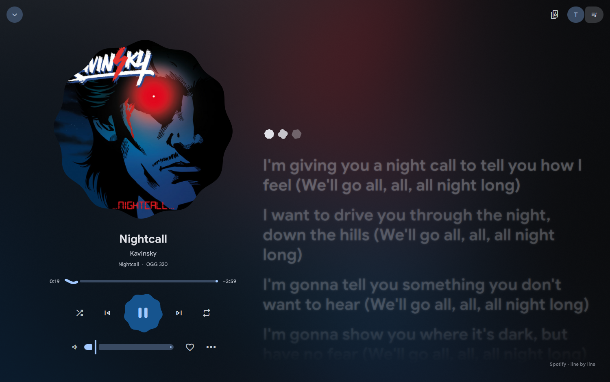
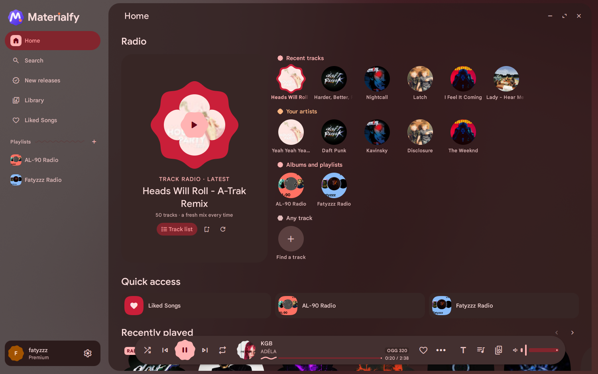
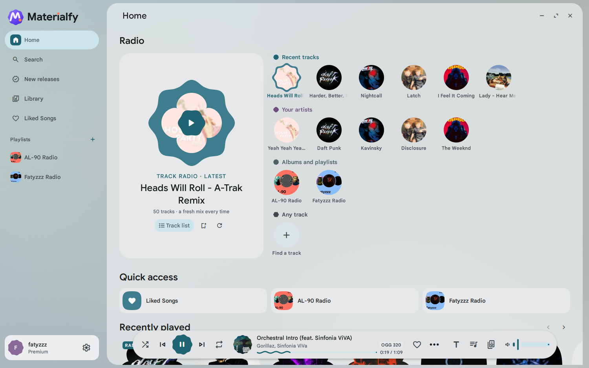
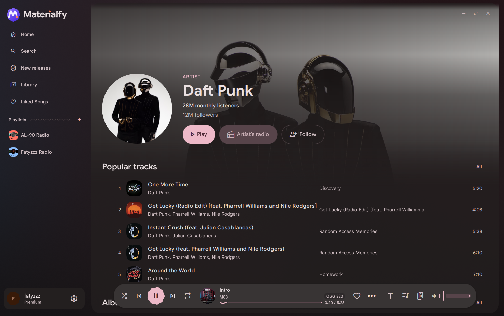
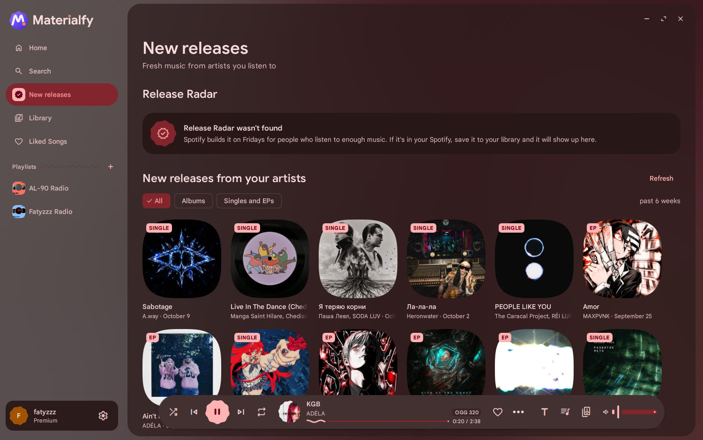
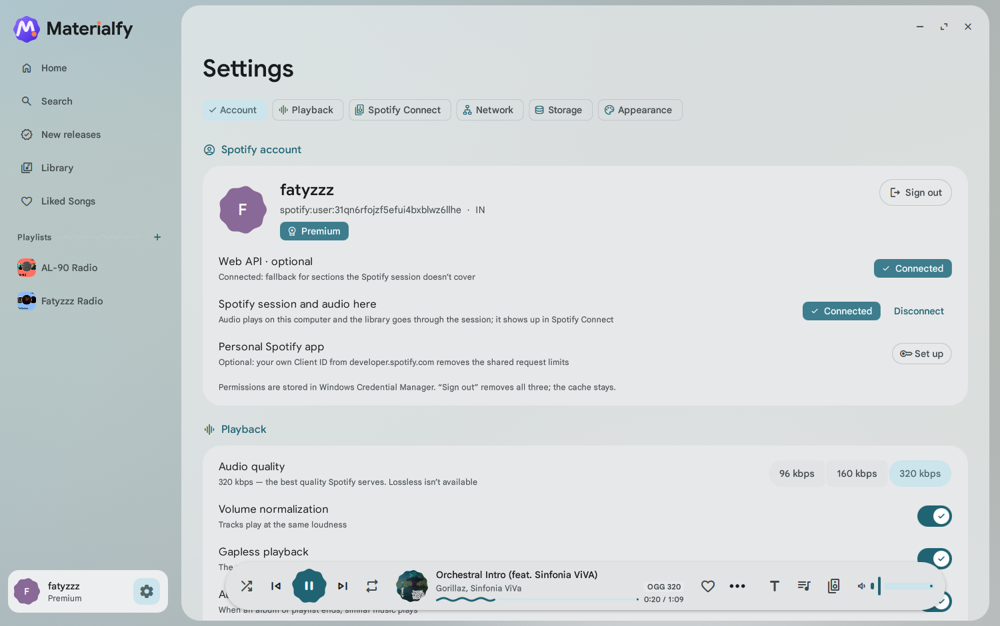
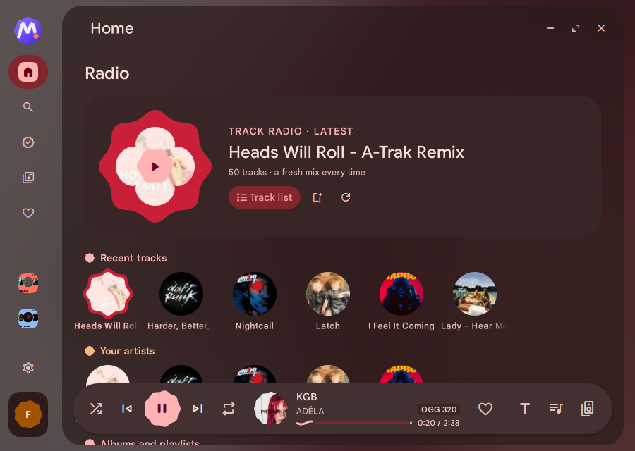
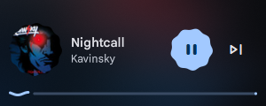

<p align="center"><b>English</b> · <a href="README.ru.md">Русский</a></p>

<div align="center">

<h1>
<picture>
  <source media="(prefers-color-scheme: dark)" srcset="docs/brand/wordmark-on-dark.svg">
  
</picture>
</h1>

[](https://github.com/Arhetip994/PixelMusic-Linux/releases)
[](#packages)
[](LICENSE)

<p><b>Modern native YouTube Music & Spotify player for Linux</b><br>
Built with Qt 6 (Material 3 Expressive) and a blazing-fast Rust backend with dynamic theme adaptation based on album art.</p>



</div>

<br>

---

## 📦 Packages for Linux

Release builds for version **1.0.0-beta** are available on the [Releases](https://github.com/Arhetip994/PixelMusic-Linux/releases) page.

| Distribution / Type | Package File | Quick Install / Run |
|---|---|---|
| **Universal (Any Linux)** | `PixelMusic-1.0.0-beta-x86_64.AppImage` | `chmod +x PixelMusic-*.AppImage && ./PixelMusic-*.AppImage` |
| **Ubuntu / Debian / Mint / Pop!_OS** | `pixelmusic_1.0.0-beta_amd64.deb` | `sudo apt install ./pixelmusic_1.0.0-beta_amd64.deb` |
| **Arch Linux / CachyOS / Manjaro** | `pixelmusic-1.0.0-beta-1-x86_64.pkg.tar.zst` | `sudo pacman -U pixelmusic-1.0.0-beta-1-x86_64.pkg.tar.zst` |
| **Portable Archive** | `pixelmusic-1.0.0-beta-linux-x86_64.tar.gz` | Extract and run `AppDir/AppRun` |

---

## ✨ Features

* **YouTube Music & Spotify:** Seamless streaming via InnerTube API, full stream cipher decryption, and algorithmic recommendations.
* **Material 3 Expressive:** Ultra-lightweight native interface written in pure Qt Quick (QML) without Electron/Chromium overhead. Minimal CPU and RAM footprint (~50-100 MB).
* **Dynamic Color Theming:** The entire UI dynamically adapts its color palette to the album cover of the currently playing track (Material You / Monet algorithms).
* **Deep Linux Desktop Integration:**
  * System media keys and taskbar control via **MPRIS2 D-Bus** specification.
  * Native **Wayland** and **X11** display server support.
  * Secure credential & token storage via Linux Secret Service (KWallet / GNOME Keyring / KeePassXC).
  * KDE Plasma Dynamic Island / Mini-player support via KWin scripts.
* **Synchronized Lyrics:** Line-by-line synced lyrics powered by LRCLIB and NetEase Cloud Music.
* **Last.fm:** Built-in scrobbling and Smart Mix playlist generation.

---

## 📸 Screenshots

<table>
  <tr>
    <td width="50%"><br><sub><b>Home (Dark Theme)</b></sub></td>
    <td width="50%"><br><sub><b>Home (Light Theme)</b></sub></td>
  </tr>
  <tr>
    <td><br><sub><b>Now Playing (Synced Lyrics)</b></sub></td>
    <td><br><sub><b>Artist Page & Top Tracks</b></sub></td>
  </tr>
  <tr>
    <td><br><sub><b>New Releases & Discoveries</b></sub></td>
    <td><br><sub><b>Audio & Theme Settings</b></sub></td>
  </tr>
  <tr>
    <td><br><sub><b>Compact Window (900×640)</b></sub></td>
    <td><br><sub><b>Mini Player Mode (300×120)</b></sub></td>
  </tr>
</table>

---

## 🚀 Installation

### 1. AppImage (Universal, works everywhere)
```bash
wget https://github.com/Arhetip994/PixelMusic-Linux/releases/download/v1.0.0-beta/PixelMusic-1.0.0-beta-x86_64.AppImage
chmod +x PixelMusic-1.0.0-beta-x86_64.AppImage
./PixelMusic-1.0.0-beta-x86_64.AppImage
```

### 2. Ubuntu / Debian / Linux Mint / Pop!_OS
```bash
wget https://github.com/Arhetip994/PixelMusic-Linux/releases/download/v1.0.0-beta/pixelmusic_1.0.0-beta_amd64.deb
sudo apt update
sudo apt install ./pixelmusic_1.0.0-beta_amd64.deb
```

### 3. Arch Linux / CachyOS / Manjaro
```bash
wget https://github.com/Arhetip994/PixelMusic-Linux/releases/download/v1.0.0-beta/pixelmusic-1.0.0-beta-1-x86_64.pkg.tar.zst
sudo pacman -U pixelmusic-1.0.0-beta-1-x86_64.pkg.tar.zst
```

---

## 🔒 Checksum Verification

SHA256 checksums are published in [SHA256SUMS.txt](https://github.com/Arhetip994/PixelMusic-Linux/releases/download/v1.0.0-beta/SHA256SUMS.txt):
```bash
sha256sum -c SHA256SUMS.txt
```

---

## 📄 License & Credits

* License: GPL-3.0-or-later.
* Upstream project: [Rajat-Solankii/PixelMusic-src](https://github.com/Rajat-Solankii/PixelMusic-src).
* Linux Port & Packages: [Arhetip994/PixelMusic-Linux](https://github.com/Arhetip994/PixelMusic-Linux).
