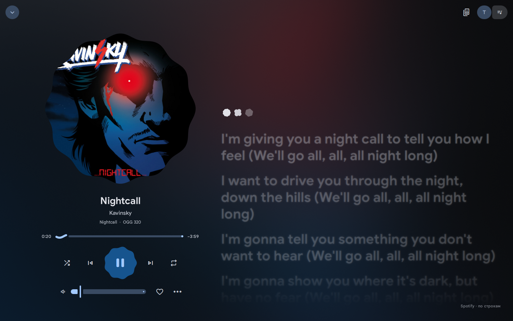
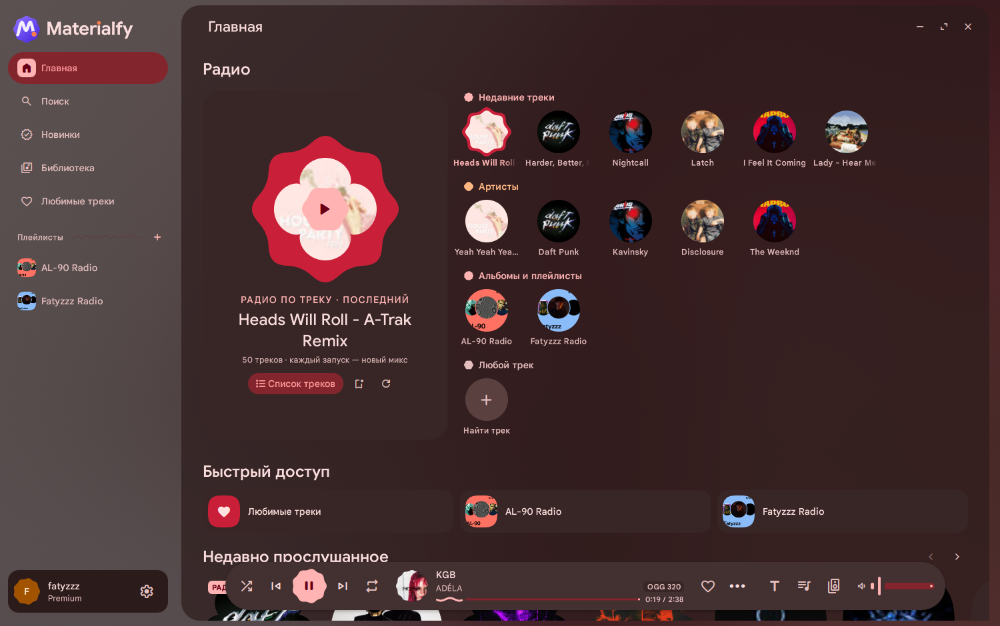
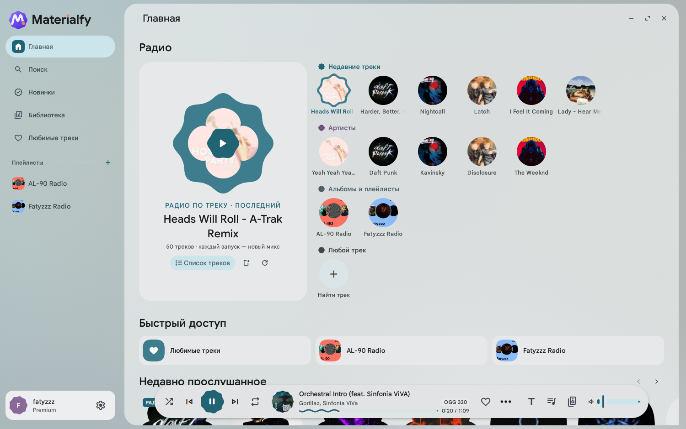
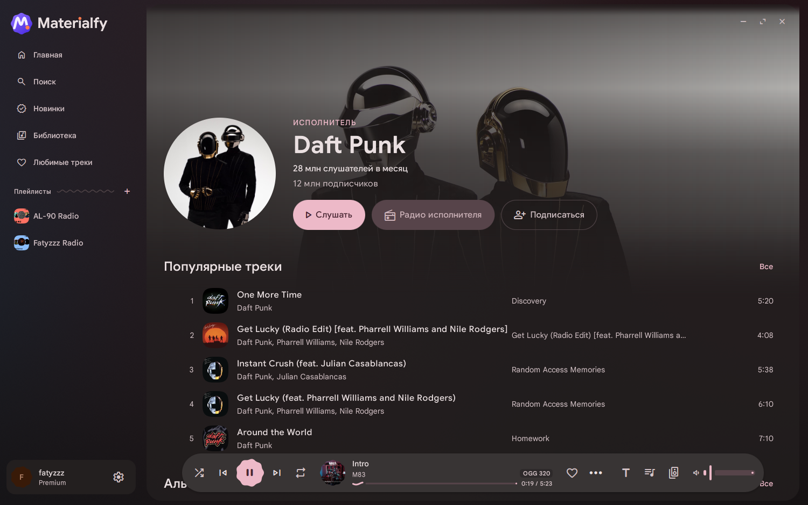
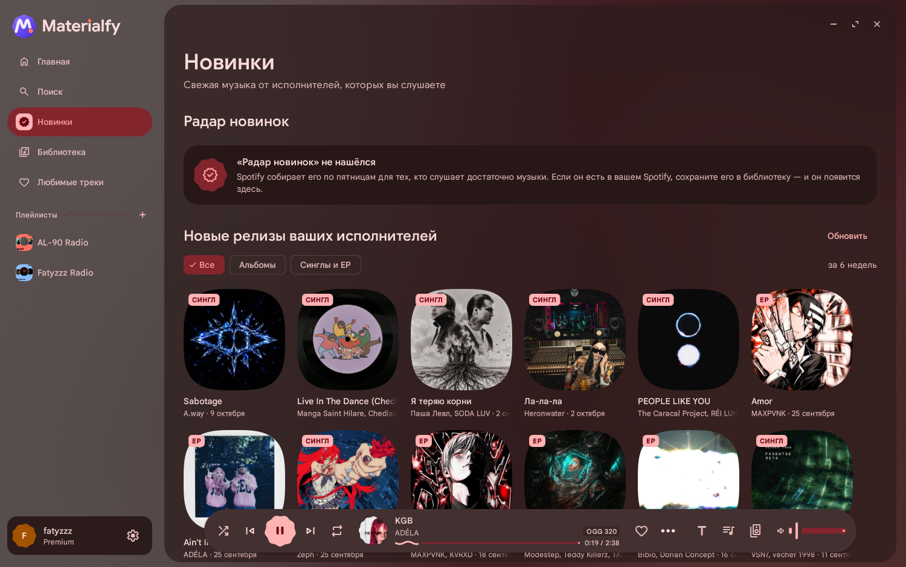
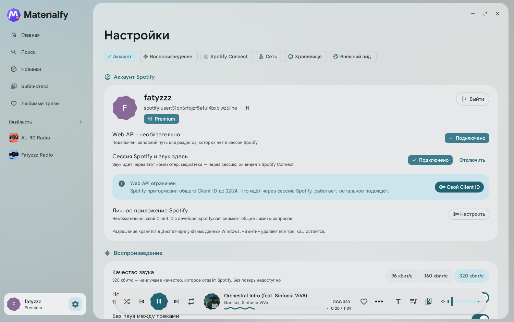
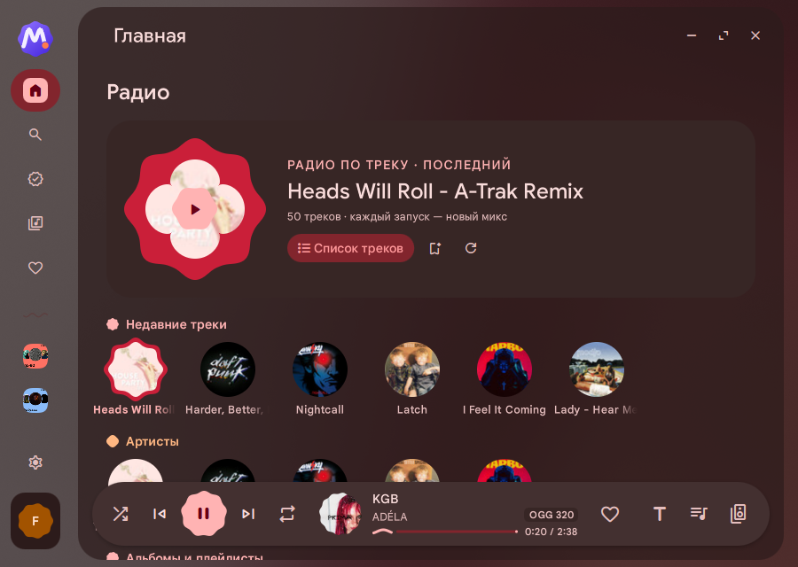
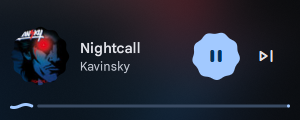

<p align="center"><a href="README.md">English</a> · <b>Русский</b></p>

<div align="center">

<h1>
<picture>
  <source media="(prefers-color-scheme: dark)" srcset="docs/brand/wordmark-on-dark.svg">
  
</picture>
</h1>

[](https://github.com/Arhetip994/PixelMusic-Linux/releases)
[](#готовые-пакеты-для-всех-дистрибутивов)
[](LICENSE)

<p><b>Современный нативный клиент YouTube Music и Spotify для Linux</b><br>
Интерфейс на Qt 6 (Material 3 Expressive) + производительный бэкенд на Rust с динамической адаптацией темы под обложку трека.</p>



</div>

<br>

---

## 📦 Готовые пакеты для всех дистрибутивов

Все релизные сборки версии **1.0.0-beta** доступны на вкладке [Releases](https://github.com/Arhetip994/PixelMusic-Linux/releases).

| Дистрибутив / Тип | Файл | Как установить / запустить |
|---|---|---|
| **Универсальный (любой Linux)** | `PixelMusic-1.0.0-beta-x86_64.AppImage` | `chmod +x PixelMusic-*.AppImage && ./PixelMusic-*.AppImage` |
| **Ubuntu / Debian / Linux Mint / Pop!_OS** | `pixelmusic_1.0.0-beta_amd64.deb` | `sudo apt install ./pixelmusic_1.0.0-beta_amd64.deb` |
| **Arch Linux / CachyOS / Manjaro** | `pixelmusic-1.0.0-beta-1-x86_64.pkg.tar.zst` | `sudo pacman -U pixelmusic-1.0.0-beta-1-x86_64.pkg.tar.zst` |
| **Портативный архив** | `pixelmusic-1.0.0-beta-linux-x86_64.tar.gz` | Распаковать и запустить `AppDir/AppRun` |

---

## ✨ Возможности

* **YouTube Music & Spotify:** Полная интеграция с InnerTube API, расшифровка стримов и алгоритмические рекомендации.
* **Material 3 Expressive:** Нативный интерфейс на Qt Quick без использования тяжелых веб-движков (Chromium/Electron). Минимальное потребление памяти (~50–100 МБ) и CPU.
* **Адаптивные цвета:** Палитра всего приложения динамически подстраивается под цвета обложки текущего трека (Material You алгоритмы).
* **Интеграция с Linux:**
  * Управление через системный медиаплеер (спецификация **MPRIS2 D-Bus**).
  * Поддержка **Wayland** и **X11**.
  * Безопасное хранение токенов в системном хранилище (Secret Service / KWallet / GNOME Keyring).
  * Поддержка островка/мини-плеера в KDE Plasma Wayland через KWin scripting.
* **Тексты песен:** Синхронизированные построчные тексты (LRCLIB, NetEase).
* **Last.fm:** Встроенный скробблинг и генерация плейлистов Smart Mix.

---

## 📸 Скриншоты

<table>
  <tr>
    <td width="50%"><br><sub><b>Главная (Тёмная тема)</b></sub></td>
    <td width="50%"><br><sub><b>Главная (Светлая тема)</b></sub></td>
  </tr>
  <tr>
    <td><br><sub><b>Воспроизведение (Синхронные тексты песен)</b></sub></td>
    <td><br><sub><b>Страница артиста и популярные треки</b></sub></td>
  </tr>
  <tr>
    <td><br><sub><b>Новые релизы и рекомендации</b></sub></td>
    <td><br><sub><b>Настройки звука и интерфейса</b></sub></td>
  </tr>
  <tr>
    <td><br><sub><b>Компактный режим (900×640)</b></sub></td>
    <td><br><sub><b>Режим мини-плеера (300×120)</b></sub></td>
  </tr>
</table>

---

## 🚀 Установка

### 1. AppImage (работает везде)
```bash
wget https://github.com/Arhetip994/PixelMusic-Linux/releases/download/v1.0.0-beta/PixelMusic-1.0.0-beta-x86_64.AppImage
chmod +x PixelMusic-1.0.0-beta-x86_64.AppImage
./PixelMusic-1.0.0-beta-x86_64.AppImage
```

### 2. Ubuntu / Debian / Linux Mint / Pop!_OS
```bash
wget https://github.com/Arhetip994/PixelMusic-Linux/releases/download/v1.0.0-beta/pixelmusic_1.0.0-beta_amd64.deb
sudo apt update
sudo apt install ./pixelmusic_1.0.0-beta_amd64.deb
```

### 3. Arch Linux / CachyOS / Manjaro
```bash
wget https://github.com/Arhetip994/PixelMusic-Linux/releases/download/v1.0.0-beta/pixelmusic-1.0.0-beta-1-x86_64.pkg.tar.zst
sudo pacman -U pixelmusic-1.0.0-beta-1-x86_64.pkg.tar.zst
```

---

## 🔒 Проверка контрольных сумм

Хэши SHA256 опубликованы в файле [SHA256SUMS.txt](https://github.com/Arhetip994/PixelMusic-Linux/releases/download/v1.0.0-beta/SHA256SUMS.txt):
```bash
sha256sum -c SHA256SUMS.txt
```

---

## 📄 Лицензия
* Лицензия: GPL-3.0-or-later.
* Исходный проект: [Rajat-Solankii/PixelMusic-src](https://github.com/Rajat-Solankii/PixelMusic-src).
* Порт и сборки для Linux: [Arhetip994/PixelMusic-Linux](https://github.com/Arhetip994/PixelMusic-Linux).
